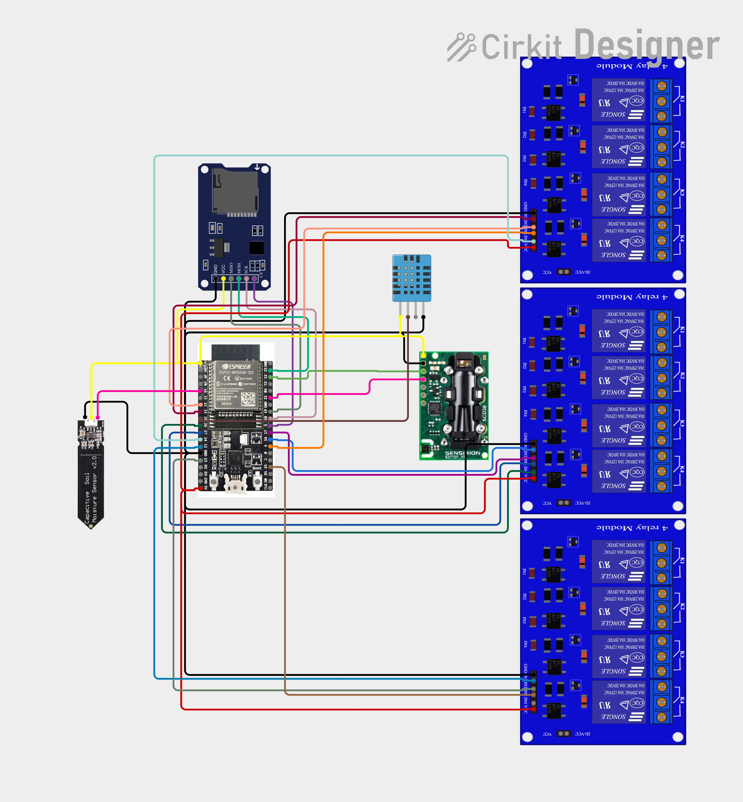

# Greenhouse Link | Conexão Estufa 🌿🍄

[Português](#português) | [English](#english)

---

## 🇧🇷 Português

O **Conexão Estufa** é um sistema de automação e monitoramento de microambientes baseado em **ESP32**, projetado para controlar com precisão o clima de estufas, tendas de cultivo ou ambientes controlados de **até 40 m²** para uma única unidade (expansível conforme a infraestrutura em volta). 

Desenvolvido com foco na robustez, baixo custo e facilidade de montagem, ele atende tanto pequenos produtores agrícolas quanto hobbistas, pesquisadores e entusiastas.

### 🎯 Aplicações e Versatilidade
Embora o foco inicial tenha sido a **produção de cogumelos** (que exigem controle rigoroso de umidade e trocas de ar), o ecossistema é altamente adaptável para:
* **Cultivo de Plantas e Mudas:** Com suporte a iluminação sequencial (progressiva), injeção de CO₂ e irrigação de solo automatizada.
* **Cuidado de Pequenos Animais:** Manutenção de temperatura e ventilação controladas.
* **Pesquisa, Experimentos e Observação:** O sistema conta com registro de logs (*Data Logging*) em cartão SD, permitindo monitorar as variações do ambiente mesmo sem usar as funções de controle ambiente com automação ativa.
* **Climatização de Pequenos Espaços:** Ajuste automatizado para conforto térmico ou testes biológicos.

---

### ✨ Principais Recursos
* **Controle Histerético Avançado:** Evita o acionamento constante e o desgaste mecânico de relés em leituras flutuantes.
* **Iluminação Progressiva de 4 Canais:** Simulação de ciclos de luz do sol para diferentes fases de desenvolvimento (vegetativo, floração ou frutificação).
* **Injeção de CO₂:** Parâmetros configuráveis para otimizar a fotossíntese em plantas.
* **Controle de Irrigação do Solo:** Leitura analógica com calibração e segurança contra falhas de sensor.
* **Armazenamento Persistente (NVS):** Todas as configurações (calibração, setpoints, fuso horário, modo Wi-Fi e tempo de retenção de logs) são salvas na memória interna do ESP32 e recuperadas automaticamente após reinicializações.
* **Sincronização NTP com Fuso Horário Configurável:** Relógio interno sempre exato ajustado via internet, com offset UTC selecionável.
* **Interface Web Nativa (Responsiva e Segura):** Acessível por qualquer navegador conectado diretamente ou pela rede local, protegida por senha, operando sem dependência de servidores externos (nuvem).
* **Gerenciamento de Histórico (SD Card):** Gravação de logs em arquivos `.txt` com rotação automática configurável por dias e ordenação inteligente na interface.

---

### ⚡ Esquema de Conexão e Pinos (Pinout)
| Pino do ESP32 | Função no Sistema | Descrição do Componente |
| :--- | :--- | :--- |
| **GPIO 02** | Saida Digital | Luz de Sistema Indicadora de Funcionamento (Pisca conforme Status) |
| **GPIO 34** | Entrada Analógica | Sensor de Umidade do Solo (Capacitivo/Resistivo) |
| **GPIO 25** | Comunicação Digital | Entrada de sinal do Sensor DHT11 (Quando Aplicado) |
| **GPIO 23** | Comunicação Digital | Conexão com Módulo Micro SD MOSI (Quando Aplicado) |
| **GPIO 05** | Comunicação Digital | Conexão com Módulo Micro SD CS (Quando Aplicado) |
| **GPIO 19** | Comunicação Digital | Conexão com Módulo Micro SD MISO (Quando Aplicado) |
| **GPIO 18** | Comunicação Digital | Conexão com Módulo Micro SD CLK (Quando Aplicado) |
| **GPIO 21** | Comunicação Digital | Conexão com Sensor SCD30 RX SDA (Quando Aplicado) |
| **GPIO 22** | Comunicação Digital | Conexão com Sensor SCD30 TX SCL (Quando Aplicado) |
| **GPIO 32** | Saída Digital (Relê 1) | Acionamento do Ventilador/exaustor (Troca de Ar) |
| **GPIO 33** | Saída Digital (Relê 2) | Acionamento do Aquecedor |
| **GPIO 04** | Saída Digital (Relê 3) | Acionamento do Umidificador |
| **GPIO 14** | Saída Digital (Relê 4) | Acionamento do Gatilho do Umidificador (Aplicável em alguns casos) |
| **GPIO 15** | Saída Digital (Relê 5) | Acionamento da Irrigação do solo (Quando em uso) |
| **GPIO 17** (TX2)| Saída Digital (Relê 6) | Injeção de CO² (Aplicável em alguns Casos) |
| **GPIO 16** (RX2)| Saída Digital (Relê 7) | Refrigeração (Usado com Ventilador ou Refrigerador) |
| **GPIO 26** | Saída Digital (Relê 8) | Acionamento da Luz Infravermelha (não confundir com luz vermelha) |
| **GPIO 27** | Saída Digital (Relê 9) | Acionamento da Luz Branca 1 (Espectro Total ou Fria) |
| **GPIO 12** | Saída Digital (Relê 10) | Acionamento da Luz Branca 2 (Espectro Total ou Quente) |
| **GPIO 13** | Saída Digital (Relê 11) | Acionamento da Luz Ultravioleta (Ideal Ultravioleta, Pode ser Branca) |
| **GPIO X** | Saída Digital (Relê 12) | Reservado (canal reserva) |
| **GND** | Resistor de 100k conectado ao **GPIO 34** | Sinal Sem Sensor (Sensor de solo) |
| **GND / 3V3 / 5V**| Alimentação | Distribuição de energia para módulos e sensores |

*[].*

---

## 🇬🇧 English

**Greenhouse Link** is an automation and monitoring system for micro-environments, based on the **ESP32** microcontroller. It is designed to precisely control the climate within greenhouses, grow tents, or controlled environments of **up to 40 m²** per unit (expandable depending on the surrounding infrastructure).

Developed with a focus on robustness, low cost, and ease of assembly, it serves a wide range of users, including small-scale agricultural producers, hobbyists, researchers, and enthusiasts.

### 🎯 Applications and Versatility
While initially developed for **mushroom cultivation**—which requires strict control over humidity and air exchange—the ecosystem is highly adaptable for:
* **Plant and Seedling Cultivation:** Supports sequential (progressive) lighting, CO₂ injection, and automated soil irrigation.
* **Small Animal Care:** Maintains controlled temperature and ventilation.
* **Research, Experiments, and Observation:** Features data logging to an SD card, allowing for the monitoring of environmental fluctuations even without active automated control.
* **Climate Control for Small Spaces:** Automated adjustments for thermal comfort or biological testing.

---

### ✨ Key Features
* **Advanced Hysteresis Control:** Prevents frequent switching and mechanical wear on relays caused by fluctuating sensor readings.
* **4-Channel Progressive Lighting:** Simulates natural sunlight cycles tailored to different developmental stages (vegetative, flowering, or fruiting).
* **CO₂ Injection:** Configurable parameters to optimize photosynthesis in plants.
* **Soil Irrigation Control:** Analog sensing with calibration and built-in fail-safes for sensor errors. * **Persistent Storage (NVS):** All settings (calibration, setpoints, time zone, Wi-Fi mode, and log retention period) are saved to the ESP32’s internal memory and automatically restored after reboots.
* **NTP Synchronization with Configurable Time Zone:** An always-accurate internal clock, synchronized via the internet, with a selectable UTC offset.
* **Native Web Interface (Responsive and Secure):** Accessible via any web browser—either through a direct connection or a local network—password-protected, and operating independently of any external (cloud) servers.
* **History Management (SD Card):** Logs are recorded in `.txt` files, featuring automatic rotation (configurable by number of days) and intelligent sorting within the interface.

---

### ⚡ Connection Diagram and Pinout
| ESP32 Pin | System Function | Component Description |
| :--- | :--- | :--- |
| **GPIO 02** | Digital Output | System Status Indicator Light (flashes according to current status) |
| **GPIO 34** | Analog Input | Soil Moisture Sensor (Capacitive/Resistive) |
| **GPIO 25** | Digital Communication | Signal Input for DHT11 Sensor (if applicable) |
| **GPIO 23** | Digital Communication | Micro SD Module Connection – MOSI (if applicable) |
| **GPIO 05** | Digital Communication | Micro SD Module Connection – CS (if applicable) |
| **GPIO 19** | Digital Communication | Micro SD Module Connection – MISO (if applicable) |
| **GPIO 18** | Digital Communication | Micro SD Module Connection – CLK (if applicable) |
| **GPIO 21** | Digital Communication | Connection to SCD30 Sensor (RX/SDA) (When applicable) |
| **GPIO 22** | Digital Communication | Connection to SCD30 Sensor (TX/SCL) (When applicable) |
| **GPIO 32** | Digital Output (Relay 1) | Fan/Exhaust Fan Activation (Air Exchange) |
| **GPIO 33** | Digital Output (Relay 2) | Heater Activation |
| **GPIO 04** | Digital Output (Relay 3) | Humidifier Activation |
| **GPIO 14** | Digital Output (Relay 4) | Humidifier Trigger Activation (Applicable in some cases) |
| **GPIO 15** | Digital Output (Relay 5) | Soil Irrigation Activation (When in use) |
| **GPIO 17** (TX2)| Digital Output (Relay 6) | CO² Injection (Applicable in some cases) |
| **GPIO 16** (RX2)| Digital Output (Relay 7) | Cooling (Used with a fan or cooler) |
| **GPIO 26** | Digital Output (Relay 8) | Infrared Light Activation (not to be confused with red light) |
| **GPIO 27** | Digital Output (Relay 9) | White Light 1 Activation (Full Spectrum or Cool White) |
| **GPIO 12** | Digital Output (Relay 10) | White Light 2 Activation (Full Spectrum or Warm White) |
| **GPIO 13** | Digital Output (Relay 11) | Activation of Ultraviolet Light (Ultraviolet is ideal; white light is also acceptable) |
| **GPIO X** | Digital Output (Relay 12) | Reserved (spare channel) |
| **GND** |  100k Resistor connected to **GPIO 34** | No Sensor Signal (Soil Sensor) |
| **GND / 3V3 / 5V** | Power Supply | Power distribution for modules and sensors |

*[].*
